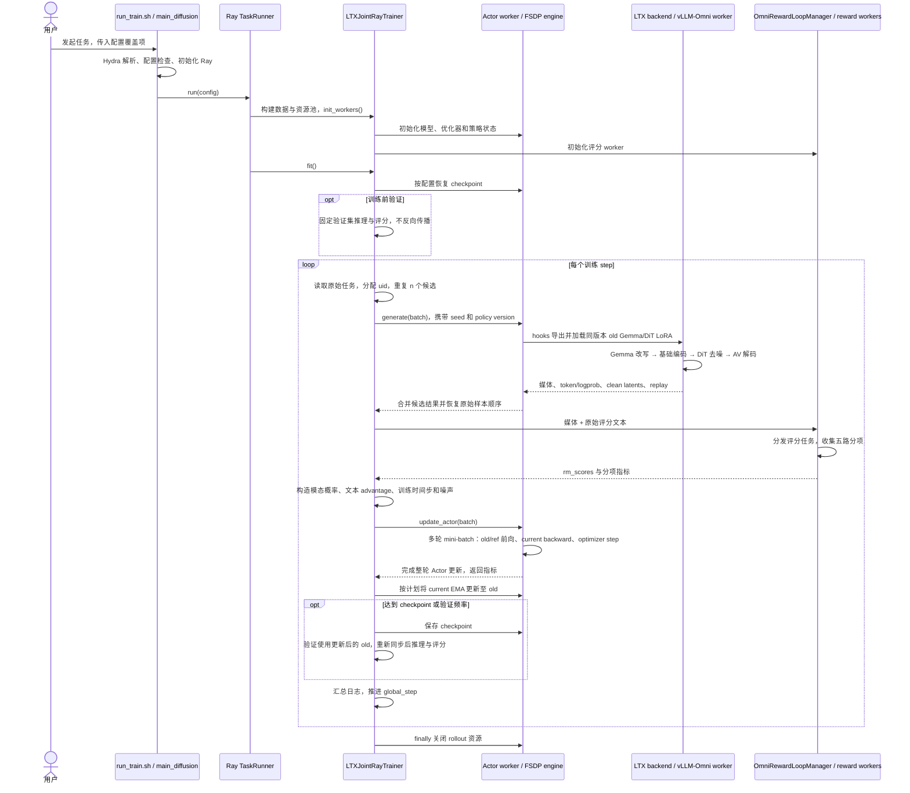
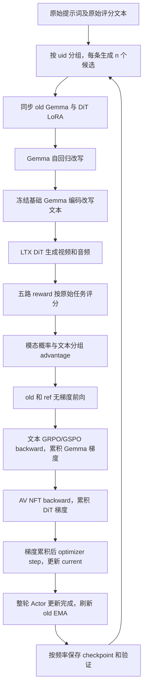
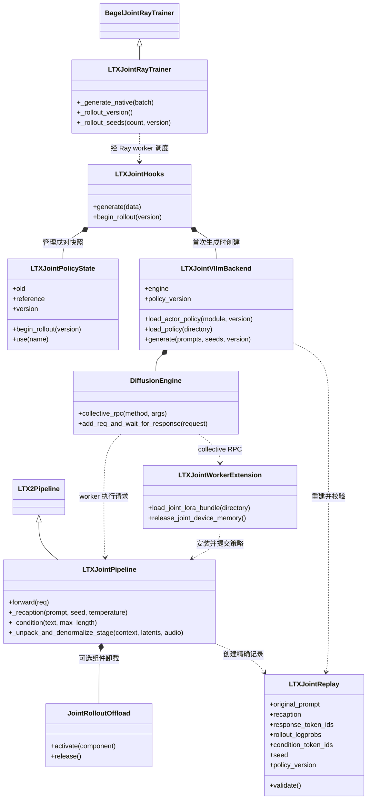
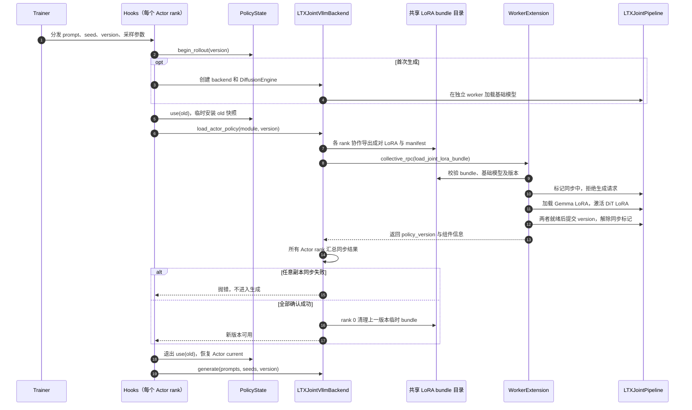
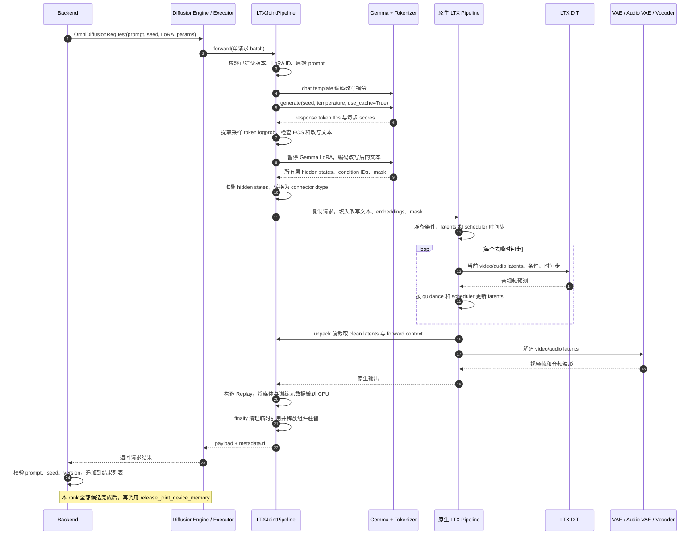
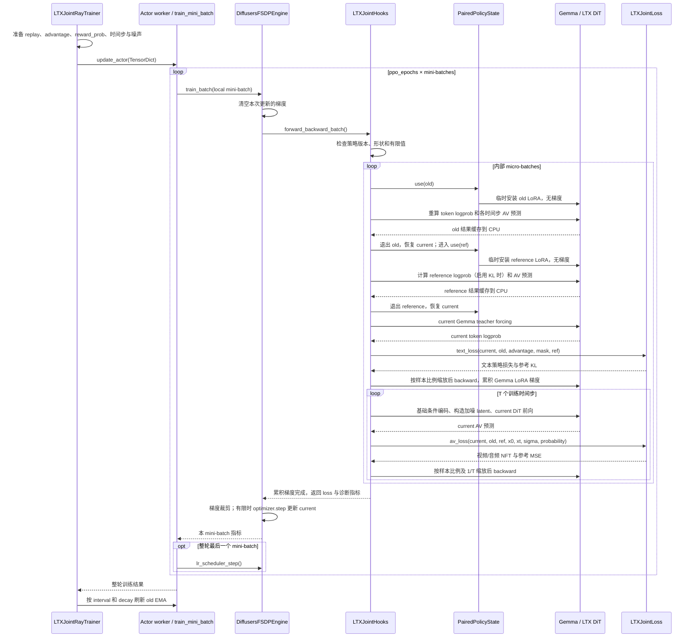

# LTX UniGRPO/NFT Trainer 实现说明

本文根据 2026-10-22 工作区代码整理。参数以 [`joint_train.yaml`](joint_train.yaml) 和实际运行生成的 Hydra 配置为准；文中的默认值不是历史实验结果或性能承诺。

## 1. 实现目标与边界

本实现将 LTX-2.3 的提示词改写与音视频生成放入同一个在线强化学习训练流程：Gemma 将原始提示词改写为音视频描述，LTX DiT 根据改写结果生成视频和音频，五路 reward 对生成结果评分，再分别更新 Gemma 和 DiT 的 LoRA。

注册的算法名是 `ltx2_unigrpo_nft`，当前文本损失默认采用 GRPO，可选择 GSPO；音视频损失复用 `OmniNFTLoss`。配置中的 `trainer_type: direct_preference` 与 `sample_source: online` 选择在线生成的 diffusion trainer 路径，不表示读取离线偏好对，也不表示训练 critic。

当前配方面向单节点 Ascend NPU，Actor 使用 FSDP2，rollout 使用多个独立单卡 worker，每个 worker 的 TP=1。启动脚本可直接执行，也可在 Docker 内执行；运行前检查模型、数据及健康检查路径是否适用于当前环境。

## 2. 代码职责

以下源码路径均相对仓库根目录。

| 文件 | 职责 |
|---|---|
| `examples/unigrpo_nft_trainer/ltx2/run_train.sh` | 环境变量检查、数据路径、设备数、日志与 Hydra 参数透传 |
| `examples/unigrpo_nft_trainer/ltx2/joint_train.yaml` | 模型、优化器、生成、reward placement 和保存策略 |
| `verl_omni/trainer/main_diffusion.py` | Hydra/Ray 入口与训练任务初始化 |
| `verl_omni/trainer/diffusion/ltx_joint_ray_trainer.py` | 联合训练调度、固定验证、策略版本、EMA 与样本保存 |
| `verl_omni/pipelines/ltx2_unigrpo_nft/hooks.py` | rollout、old/ref/current 前向、文本及 AV 分支 backward |
| `verl_omni/pipelines/ltx2_unigrpo_nft/model.py` | Gemma、connector、DiT 的训练侧组合、条件编码与 `base_encoder` 上下文 |
| `verl_omni/pipelines/ltx2_unigrpo_nft/attention.py` | Connector 与 DiT 的原生推理算术对齐及可微 LoRA 投影 |
| `verl_omni/pipelines/ltx2_unigrpo_nft/loss.py` | 文本信用分配、训练噪声、文本/AV 损失组合 |
| `verl_omni/trainer/diffusion/recaption_grpo.py` | 分组 advantage、GRPO/GSPO、文本参考 KL 与一致性指标 |
| `verl_omni/trainer/diffusion/diffusion_algos.py` | OmniNFT reward 归一化、模态路由和 NFT 目标 |
| `verl_omni/workers/rollout/ltx_joint_backend.py` | 原生 DiffusionEngine、逐样本推理和成对权重同步 |
| `verl_omni/pipelines/ltx2_unigrpo_nft/vllm_omni_rollout_adapter.py` | Gemma 改写与原生 LTX 音视频生成、replay 返回 |
| `verl_omni/pipelines/ltx2_unigrpo_nft/policy_state.py`、`weight_sync.py` | 成对策略快照、版本校验、LoRA 导出 |
| `verl_omni/pipelines/ltx2_unigrpo_nft/replay.py`、`artifacts.py` | 改写指令、精确生成记录、媒体与提示词/reward 落盘 |

建议按以下顺序阅读，不必逐个打开所有模块：

1. [run_train.sh](run_train.sh) 与 [joint_train.yaml](joint_train.yaml)：启动入口和参数。
2. [ltx_joint_ray_trainer.py](../../../verl_omni/trainer/diffusion/ltx_joint_ray_trainer.py) 与 [hooks.py](../../../verl_omni/pipelines/ltx2_unigrpo_nft/hooks.py)：训练调度、old/ref/current 前向、两路 backward。
3. [vllm_omni_rollout_adapter.py](../../../verl_omni/pipelines/ltx2_unigrpo_nft/vllm_omni_rollout_adapter.py)：按“改写文本 → 条件编码 → 音视频生成 → replay”阅读。
4. [model.py](../../../verl_omni/pipelines/ltx2_unigrpo_nft/model.py)、[attention.py](../../../verl_omni/pipelines/ltx2_unigrpo_nft/attention.py) 与 [loss.py](../../../verl_omni/pipelines/ltx2_unigrpo_nft/loss.py)：模型、精度对齐和训练目标。
5. [offload.py](../../../verl_omni/pipelines/ltx2_unigrpo_nft/offload.py)、[policy_state.py](../../../verl_omni/pipelines/ltx2_unigrpo_nft/policy_state.py) 与 [weight_sync.py](../../../verl_omni/pipelines/ltx2_unigrpo_nft/weight_sync.py)：组件驻留、策略快照和成对 LoRA 同步。

其余模块按需查阅：`config.py` 定义模型配置；`diffusers_training_adapter.py` 接入训练引擎；`replay.py` 定义改写与回放协议；`rewards.py` 转换评分输入并提供离线评分入口；`artifacts.py` 保存样本；`text_diagnostics.py` 负责文本对拍。目录保留 15 个 Python 文件（含 `__init__.py`），原有模型与 replay 类路径不变。

### 2.1 权重搬运与保留的检查

本分支使用普通 `.to(device, non_blocking=False)` 做双向搬运，不保留冻结权重或 LoRA 的 CPU 主副本。`offload.py` 管理六个 rollout 组件；五个 reward 模型通过 `transfer_sync.move_module` 迁移。Actor/FSDP 的参数存储仍由训练引擎管理。

- 卸载时将当前设备权重 D2H，激活时再 H2D；迁移前后同步设备。原生 LoRA sidecar 也迁移，且保持可写，供下一次策略加载使用。
- Gemma 与 DiT 的 LoRA 在同一版本全部加载完成后才发布版本；更新未完成时禁止执行 rollout。
- 文本检查保留在 `text_diagnostics.py`：R 是生成时记录的 logprob，R′ 是 rollout 同策略重算，T 是 Actor old-policy 重算。对比必须对应相同 token、mask 和 policy version。配置入口仍为 `actor_rollout_ref.rollout.ltx_joint.text_diagnostics`。
- HPS 健康检查保留，配置入口仍为 `reward.models.hpsv3.executor.kwargs.health_check`；它验证固定样本的评分行为，与文本对拍相互独立。

已删除针对 Gemma 第 47 层的临时 `weight_guard.py`、AV/MSProbe 对拍 RPC、专用启动脚本和配置。旧启动命令需去掉 `text_diagnostics.frozen_weight_guard` 覆盖项；常规文本检查和 HPS 检查参数不变。历史输出与证据不随清理删除。本实验分支取消依赖 CPU 主副本的全量搬运比对；文本对拍和 HPS 固定输入检查仍可开启。这是传输路径对照实验，不代表已消除偶发损坏。

`LTXJointRayTrainer` 继承 `BagelJointRayTrainer`，复用分组分发等公共能力，并覆盖 LTX 的更新、验证和产物逻辑。

## 3. 端到端主流程

### 3.1 任务发起与初始化

`run_train.sh` 将数据路径、设备数和用户覆盖参数传给 `verl_omni.trainer.main_diffusion`。Hydra 合并并解析配置，入口完成设备与配置检查，再初始化 Ray，由远程 `TaskRunner.run()` 创建数据集、DataLoader、资源池和 Trainer。

算法名 `ltx2_unigrpo_nft` 使 `_get_trainer_cls()` 选择 `LTXJointRayTrainer`。实际继承链为 `LTXJointRayTrainer → BagelJointRayTrainer → NativeRayDiffusionTrainer → PolicyGradientRayTrainer`，训练主循环来自 `NativeRayDiffusionTrainer.fit()`。配置中的 `direct_preference` 不能直接理解为执行 `DirectPreferenceRayTrainer.fit()`。

`init_workers()` 建立 Actor worker group 和 `OmniRewardLoopManager`；Actor 初始化 FSDP 模型、优化器及成对策略状态。进入 `fit()` 后先恢复 checkpoint，再按配置执行训练前验证。LTX 推理由 hooks 持有的 backend 调度，通用的 `checkpoint_manager` 在这条路径中是 `NoOpCheckpointManager`，不负责推理权重同步。

### 3.2 主流程时序图

图中每个 Actor rank 都有自己的 hooks/backend，推理服务端是独立的 vLLM-Omni diffusion worker。为便于阅读，省略各 rank 的重复调用。

checkpoint 和验证各自按频率触发，图中同一可选区域不表示二者必须同时发生。训练样本的媒体与评分来自该步优化之前的 rollout；验证样本来自该步 Actor 更新和 old 刷新之后的策略。样本产物可在准备训练 batch 时落盘，不能通过文件写入时间判断其使用了更新前还是更新后的权重。

### 3.3 一个 step 的数据与阶段边界

每个候选都保留原始任务、实际生成 token、生成参数、seed、policy version、干净 AV latents 等 replay 信息。训练使用已采样 token 进行 teacher forcing，不在 Actor 更新时重新采样提示词。原始 `prompt_av` 用于生成任务，数据中的 `prompt_v`、`prompt_a` 用作对应模态的评分目标；改写文本不会替换原始 reward 目标。

主循环同步等待生成、评分和训练各阶段完成，下一轮 rollout 不与当前 optimizer update 流水重叠。reward 在完整媒体生成后执行，不在去噪中途评分。`OmniRewardLoopManager` 根据配置选择评分执行路径；命名模型路径会分组提交远程评分任务、等待结果并恢复样本顺序，保留五路分项供训练使用。评分器不参与反向传播。

权重更新分为三个时机：mini-batch 的优化器更新 **current**；整轮 `update_actor()` 返回后，Trainer 按计划刷新 **old**；下一次训练或验证生成开始前，hooks/backend 将成对 **old** 权重同步到推理端。reference 始终保持固定。具体同步协议见 4.4 节。

## 4. 推理过程与对象关系

### 4.1 进程与并行边界

推理由 Trainer 调度，但实际模型计算在独立的 vLLM-Omni diffusion worker 进程中执行。每个 Actor rank 经 `LTXJointHooks` 持有一个 `LTXJointVllmBackend`，后者创建 `DiffusionEngine`，通过 multiprocess executor 向单卡 worker 发送请求。

Gemma 改写在该 diffusion worker 内调用 Transformers `generate()`，并不是独立 vLLM 自回归服务。改写、条件编码、DiT 去噪、视频与音频解码属于同一个请求的连续阶段。

每个 worker 的 TP=1，当前仅接收单请求 batch；backend 用循环串行处理本 rank 的候选。多个 rank 同时工作，构成样本级并行。FSDP2 负责训练参数分片，不意味着生成一个视频时使用多卡 tensor parallel。

### 4.2 UML 类图

下图使用 Mermaid `classDiagram` 表达实现中的继承、持有和调用关系。外部框架类仅保留与推理有关的方法，不表示完整接口。

Worker extension 与 pipeline 运行在同一个推理 worker 内；extension 通过 model runner 访问 pipeline。图中的 RPC 箭头跨越进程边界，普通持有关系不表示模型权重在 Actor 和 worker 间共享内存。

### 4.3 请求分组、seed 与分发

Trainer 为每条原始 prompt 生成同组候选，使用 `uid` 标识归属。分发前写入 `_ltx_policy_version`、`_ltx_sample_seed` 和生成参数。训练 seed 按 `base_seed + version × count + 样本序号` 产生；验证使用 `base_seed + 样本序号`。

分发采用 `reshape(-1, group_size).T.reshape(-1)` 的重排方式，将同一 prompt 的候选散布到不同副本，避免某个慢 prompt 的全部候选集中到一张卡。生成结束后再逆置换，恢复原始候选顺序，使 reward 与 advantage 的分组保持一致。

验证样本数不整除 world size 时，只在分发阶段补齐请求，让所有 Actor rank 都参加成对权重导出。重复请求保留原 seed，返回后移除 padding，不进入真实样本评分。

### 4.4 权重同步时序

每次 rollout 生成之前，需要把 Actor 的 old Gemma/DiT LoRA 同步到原生 worker。初次调用还会加载基础模型；后续调用复用 backend，更新成对 adapter。

Gemma 使用 PEFT adapter，DiT 使用原生 LoRA manager。请求中的 DiT LoRA ID 与已提交的成对策略关联，不能混用某一版 Gemma 和另一版 DiT。任何同步中状态、版本不一致或 adapter ID 不一致都会导致请求失败。

这里的 `collective_rpc` 是 engine 到推理 worker 的控制调用；导出权重时各 Actor rank 的协作同步是另一层通信。生成期间父进程停在等待 RPC 返回的位置，本身不能证明 collective 通信卡死。

### 4.5 单样本推理时序

下面展开一个 worker 中的单个候选。其他 worker 同时执行自己的请求；同一 worker 在本请求返回后才处理下一个候选。

### 4.6 Gemma 改写与条件编码的区别

改写指令由 `planning_instruction()` 构造。该函数保留了历史命名，但当前协议要求直接输出最终音视频描述：`planning=None`、`response_format="caption"`，没有独立 planning 阶段。视频时长 `(num_frames−1)/frame_rate` 也参与改写指令构造。

改写阶段开启 Gemma 策略 LoRA。采样配置是 `do_sample=True`，使用指定 temperature，`top_k=0`、`top_p=1`、`typical_p=1`、`repetition_penalty=1`。`max_new_tokens` 是长度上限，正常终止依赖 EOS。`fork_rng` 中设置当前请求的 CPU/设备 seed，并在退出时恢复外部 RNG 状态。

`output.scores` 保存每次生成返回的 processed scores；代码转 FP32、执行 log-softmax，再抽取实际采样 token 的 logprob。这里保留的是完整生成 response 的 token 信息，不能只用可见文本重新 tokenize 来替代它。

改写成功后，`_condition()` 对最终文本重新编码：左侧 padding 到上下文长度，不允许静默截断；长度超限直接报错。此阶段使用 `no_grad` 和 `base_encoder()` 关闭 Gemma LoRA。各层 hidden states 堆叠并展平为 LTX 所需的布局，转成 connector dtype 后传入原生 pipeline。原生负向文本编码同样使用基础 Gemma 路径。

因此生成时存在两次用途不同的 Gemma 计算：第一次决定输出哪些改写 token，第二次把已确定的改写文本转换为冻结条件特征。二者不共享一条可微采样链。

### 4.7 原生去噪、解码与显存管理

`LTXJointPipeline` 不重新实现 LTX scheduler 或完整去噪循环，而是通过 `super().forward()` 调用原生 LTX pipeline。复制后的请求携带改写文本、预计算 embeddings、mask 和原始采样参数，原生路径完成 connector、音视频 latent 初始化、guidance、逐步去噪及解码。

`_unpack_and_denormalize_stage()` 在原生 unpack/denormalize 之前截取 clean latents 和 forward context，并按原始音频长度裁去填充部分。截取结果用于训练 replay；解码结果用于 reward 和媒体展示。训练不能用压缩视频文件替代这些 clean latents。

CPU offload 通过 `JointRolloutOffload` 管理 Gemma、connector、DiT、VAE、audio VAE、vocoder 等组件的驻留，也处理 DiT LoRA 的 sidecar 张量。它降低显存同时驻留量，但会引入 CPU/设备搬运开销，不会让单个 worker 的请求并行执行。

Gemma 从原始权重以 FP32 加载；DiT 等组件主要使用 BF16。代码没有把已舍入的 BF16 Gemma 简单转成 FP32 充当原始 FP32 权重。精度、offload 和实际后端版本都会影响性能及数值复现。

### 4.8 返回协议与异常处理

返回结果使用 `payload` 与 `metadata.rl` 封装。媒体沿公共 `media_key="video"` 通道携带 `(video, audio)`，不是只返回视频。

| 返回内容 | 后续用途 |
|---|---|
| 视频、音频、fps、采样率 | reward 输入与样本展示 |
| 原始 prompt、recaption、完整 response | 原始任务核对、改写展示 |
| prompt/response token IDs、logprobs、EOS | 文本 teacher forcing 和一致性诊断 |
| condition token IDs 与 mask | 重建 AV 条件编码输入 |
| clean video/audio latents、训练时间步 | Actor NFT 前向重放 |
| seed、policy version、生成参数 | 样本身份与策略一致性校验 |
| 改写/生成耗时、峰值显存 | rollout 性能统计 |

请求中 `output_type="pt"` 表示原生 pipeline 返回内存张量，**并不意味着保存 `.pt` 文件**。是否落盘由 trainer 的 artifacts 层另行控制。

backend 重建 `LTXJointReplay` 后，逐个核对原始 prompt、seed 和 version，并检查媒体形状。所有候选完成后，Hooks 将媒体转换为 `DataProto`，附加 replay、clean latents、时间步和性能信息，交回 Trainer；五路 reward 在生成返回之后执行，不在 Gemma/LTX worker 的去噪循环内执行。

空提示词、空改写、协议/EOS 不合格、条件长度超限、缺失 clean latents 或策略不匹配均会明确失败，不静默回退到原始提示词。改写协议错误包含 seed、version、response 长度及实际生成文本，便于定位未进入周期保存的失败样本。`forward()` 的 `finally` 清除临时引用并释放组件驻留，但这不等于任意异常后都可以无条件继续训练。

## 5. 参数与梯度边界

训练参数限定为 Gemma 语言模型 attention 和 LTX transformer attention 中的默认 LoRA A/B 矩阵；其他基础权重冻结。当前 rank=32、alpha=32。

| 计算路径 | Gemma LoRA | DiT LoRA | 条件编码器/connector |
|---|---|---|---|
| 改写 token 的文本 GRPO/GSPO | 接收梯度 | 不参与文本预测 | 不参与文本目标 |
| 视频/音频 NFT | 不接收 AV 梯度 | 接收梯度 | 无梯度基础编码 |
| old/ref 前向 | 不更新 | 不更新 | 无梯度 |

`model.py::encode_condition()` 带 `@torch.no_grad()`，并通过 `base_encoder()` 临时关闭 Gemma LoRA。它把基础 Gemma 的各层 hidden states 堆叠、展平后交给 connector。改写用的是策略 Gemma，改写结果的 AV 条件编码用的是冻结基础 Gemma。

因此这里的“联合训练”是同一 rollout/reward 驱动两组参数更新，不代表 AV 损失穿过离散采样 token 或条件编码器反传到 Gemma。旧实验中关于 AV→Gemma 梯度的描述不能套用到当前代码。

## 6. Reward 与两路训练目标

### 6.1 五路 reward

`rewards.yaml` 使用 `preserve_components` 保留分项，不能把五路原始分数直接视为同一个量纲的指标。

| Reward | 主要用途 | video 路由权重 | audio 路由权重 |
|---|---|---:|---:|
| VideoAlign | 视频质量/文本对齐分项 | 1.0 | 0.0 |
| HPSv3 | 视频抽帧的视觉偏好 | 1.5 | 0.0 |
| AudioBox | 音频美学分项 | 0.0 | 0.5 |
| CLAP | 音频与原始音频描述对齐 | 0.0 | 1.0 |
| DeSync | 音视频同步评分 | 1.0 | 1.0 |

先计算各 reward 的分组 advantage，再按上述矩阵路由到 video/audio。当前连续概率映射为：

`p_m = clamp(0.5 + A_m / (2 × adv_clip_max), 0, 1)`，其中 `m` 为 video 或 audio，默认 `adv_clip_max=5`。

当前 `global_std=true`，具体归一化由 `OmniNFTLoss._compute_component_advantages()` 实现。模态路由权重和损失中的 `video_weight/audio_weight` 是不同层次的配置。

### 6.2 文本 GRPO/GSPO

默认 `text_advantage_source=modality_probability`：先取 `(p_video + p_audio) / 2`，再在相同原始 prompt 的候选组内减均值、除总体标准差加 epsilon。组内奖励完全一致时 advantage 为零。

可选 `combined_reward` 使用五路 `rm_scores` 的原始总和作为文本奖励，再做组内标准化；这会改变文本信用分配，不改变 AV 的概率路由。

GRPO 使用当前与 old 的 token 概率比，并在 `1 ± ar_clip_ratio` 内裁剪；只统计有效 response token，排除 prompt 和 padding。先对每个样本的 token 求均值，再对样本求均值。GSPO 选项改用长度归一化的序列概率比。

**实际 loss 分母来自 Actor 对 old 策略的重新计算。** rollout 保存的 logprob 用于 old-policy 一致性诊断，而不是直接作为当前训练路径的 GRPO 分母。

文本目标还包含相对固定 reference 的采样 token k3 KL 估计，默认系数 `0.001`；这不是对整个词表计算的精确 KL。

### 6.3 音视频 NFT

每个模态使用同一份 clean latent、训练时间步和噪声，分别得到 current、old 和 reference 的预测。噪声按 replay seed 和模态 salt 构建独立 generator，降低 batch 重排与全局 RNG 对训练噪声的影响。

OmniNFT 以 current/old 构造正、负预测，转换成 x0 重建项，再由模态概率加权。简写为：

- `positive = β × current + (1 − β) × old`
- `negative = (1 + β) × old − β × current`
- `predicted_x0 = noisy_latent − sigma × prediction`

重建误差采用实现中的自适应归一化，并加上 current/reference 预测之间的 MSE 正则。默认 `β=1`，video/audio 损失权重均为 1，两个 reference MSE 系数均为 `1e-4`。所谓 AV `ref_kl` 指的是该预测 MSE，并非文本概率分布的 KL。

### 6.4 训练输入与批次层次

`_prepare_actor_batch()` 将已评分的 rollout 转为训练输入，检查 replay 完整性、策略版本和分数，再通过 `LTXJointLoss.prepare_actor_batch()` 准备两路目标。

| 输入 | 训练侧用途 |
|---|---|
| `ltx_joint_replay` | 重放实际 prompt/response token、mask、采样温度、生成几何与策略版本 |
| `rm_scores`、`uid` | 按同一原始任务的候选组计算信用分配 |
| `text_advantages[B]` | 每个改写序列的 GRPO/GSPO advantage |
| `reward_prob[B,T,2]` | 每个训练时间步的视频/音频 NFT 概率 |
| `train_timesteps[B,T]` | 模型尺度的训练时间步，要求有限且在 `(0,1000]` |
| video/audio clean latents 与 forward noise | 构造相同的加噪输入，供 current/old/reference 比较 |

这里 `B` 是候选样本数，`T` 是选取的训练时间步数，不是生成视频帧数，也不是完整 rollout 去噪步数。训练会对 clean latent 重新加噪计算目标，不反传完整生成轨迹。

Trainer 将 batch 转为 TensorDict，并传入 `ppo_epochs`、`ppo_mini_batch_size`、shuffle 与 DataLoader seed。`ppo_mini_batch_size` 按完整的“改写 + 音视频候选”计数，不按原始 prompt 数计数。worker 按数据并行大小划分本地 mini-batch，engine 再调用联合 hooks，hooks 内按 `ppo_micro_batch_size_per_gpu` 拆分。

一次训练 step 可以包含多轮 epoch、多个 optimizer step；每个 micro-batch 内有一次文本 backward 和 `T` 次 AV backward，它们共同累积到当前 mini-batch 的梯度。old/reference 在整轮 Actor 更新期间不随各 mini-batch 改变。

### 6.5 训练侧时序图

### 6.6 前向、反向与优化器边界

每个内部 micro-batch 必须先完成 old/ref 的无梯度前向，再构建 current 图。old/ref 预测缓存到 CPU，当前损失计算时再移动到对应设备。不能在 current forward 与 backward 之间切换 live policy 参数，否则可能破坏 autograd 保存的张量。

文本分支对实际生成的 response token 做 teacher forcing，以 Actor 重算的 old logprob 为概率比分母，按 response mask 排除 prompt/padding，计算 GRPO/GSPO 和参考 KL。其 backward 只更新 Gemma LoRA 的梯度。

AV 分支对每个训练时间步，以相同 clean latent、噪声和条件分别比较三种策略预测。条件编码始终使用关闭 LoRA 的基础 Gemma，且不建立梯度图；current DiT 的 NFT 与参考 MSE 损失只向 DiT LoRA 反传。reward 数值和离散采样 token 均不参与反向传播。

设本地 mini-batch 有 `M` 个样本，当前 micro-batch 有 `m` 个样本，hooks 将文本 loss 乘以 `m/M`，将每个时间步的 AV loss 乘以 `m/(M×T)` 后 backward。这样 micro-batch 和时间步循环实现平均目标的梯度累积；hooks 自身不调用 optimizer.step。

engine 完成梯度裁剪并取得梯度范数：有限时执行 optimizer.step，非有限时清空梯度并跳过该次参数更新。worker 仅在整轮最后一个 mini-batch 后推进学习率 scheduler；这是当前实现的调度粒度，不是每次 backward 都推进。整轮返回后 Trainer 才执行 old 的 EMA 更新，下一次生成前再同步推理权重。

## 7. current、old、reference 与权重同步

| 策略 | 用途 | 更新时机 |
|---|---|---|
| current | 优化器实际更新的 Gemma/DiT LoRA | 每个 optimizer step |
| old | rollout 策略、训练概率比分母、AV old prediction | 整轮 Actor 更新结束后按计划刷新 |
| reference | 文本 KL、AV reference prediction | 初始快照，恢复时从 checkpoint 读取 |

old/reference 是每个 rank 的 CPU 参数快照，不是额外 PEFT adapter 名称。临时安装快照执行无梯度前向后恢复 current；哈希检查用于发现冻结快照被意外修改。

默认每轮更新 old，EMA 为 `old ← decay × old + (1 − decay) × current`。`linear_to_0_5` 对应 `decay=min(step × 0.001, 0.5)`。

策略版本为：初始验证 0，训练 step s 为 `2s−1`，该步更新后的验证为 `2s`。Gemma/DiT 必须成对导出和加载；所有副本确认新版本后才清理上一版本临时 bundle。临时 bundle 不是完整训练 checkpoint。

## 8. 复现与排查

相同 seed 不保证逐 token、逐像素一致；还要求权重、采样参数、随机数消耗顺序、精度、软件版本和数值执行路径一致。概率分布略有变化时，同一随机数也可能抽到不同 token，继而改变整个视频和 reward。checkpoint 重生成应称为重新评估，未经验证不能声称逐位恢复历史样本。

当日志停在 Gloo 初始化附近时，先检查是否有异常，以及 worker 是否仍在 Gemma、DiT、解码或 offload 中执行。`connected ... Expected ...` 数量一致本身不是通信错误。父进程等待推理 RPC，也不等同于死锁。

关注 `rollout/recaption_time`、`rollout/generation_time`、`rollout/sync_time`、`reward/total_time`、`train/total_time`、`step/total_time` 和 old-policy 概率比诊断。多个 rank 并行工作时，不能把各 rank 时间直接相加当作 wall time。

## 9. 验证范围

相关自动化测试位于 `tests/pipelines/test_ltx2_joint_*_on_cpu.py`、`tests/trainer/diffusion/test_ltx_joint_trainer_on_cpu.py`、`test_recaption_grpo_on_cpu.py` 和 checkpoint/reward 测试中。它们覆盖协议、梯度边界、分组目标、产物与恢复状态等行为。

CPU 测试不等于真实 NPU 全流程验收，历史实验结果也不能替代当前配置的性能或质量评估。本次整理的 376 项相关 CPU 回归测试通过；Ruff 检查通过。NPU 7 上以小张量验证了 FP32/BF16 六组件切换、两次 LoRA 版本更新、reward 往返搬运及设备损坏注入拦截。没有启动完整模型训练，也未据此宣称偶现传输故障已被排除。
